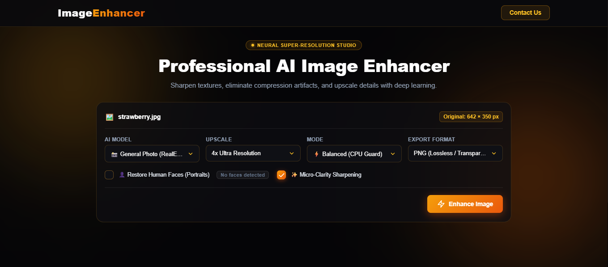
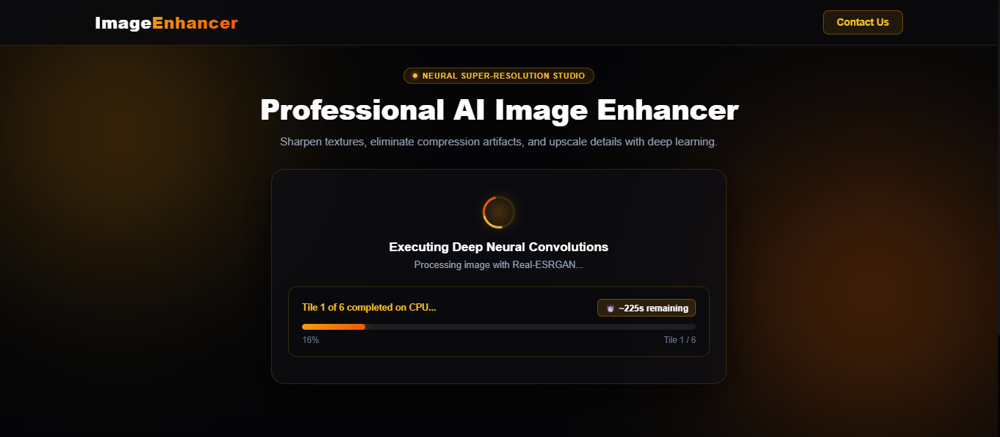
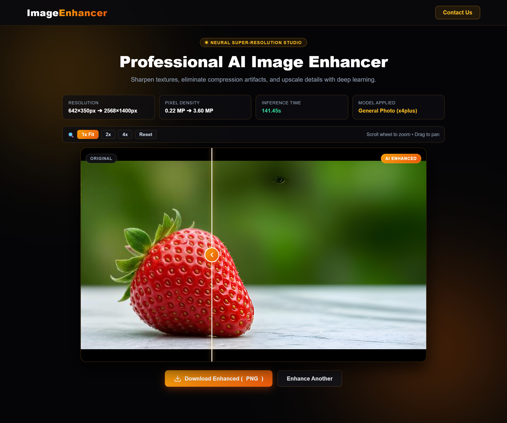

# Image Enhancer

A professional AI-powered image enhancement tool that upscales images, sharpens details, and improves image clarity using **Real-ESRGAN**.

The application provides a configurable enhancement workflow, processing progress, and an interactive before-and-after preview so you can inspect the result before downloading it.

### 1. Enhancement Settings

Choose the AI model, upscale factor, processing mode, and export format before starting. Optional enhancement controls are also available.

### 2. Enhancement in Progress

The processing screen displays the current stage, tile progress, and estimated remaining time while the image is being enhanced.

### 3. Enhanced Result

Review the original and enhanced image using the comparison slider. Zoom controls make it easier to inspect details, and the result can be downloaded when you're satisfied.

## Major Features

- **AI Image Upscaling:** Enhance image resolution using the Real-ESRGAN model.
- **4× Ultra Resolution:** Increase image dimensions with the 4× upscale option.
- **AI Model Selection:** Choose the available enhancement model, including the General Photo model.
- **Processing Modes:** Select processing modes, including Balanced (CPU Guard).
- **Face Restoration:** Enable face restoration for portrait images when needed.
- **Micro-Clarity Sharpening:** Apply additional sharpening to bring out fine details.
- **Multiple Export Formats:** Choose the desired output format, including PNG (lossless / transparency).
- **Live Processing Feedback:** View the processing stage, tile completion, progress percentage, and estimated remaining time.
- **Before-and-After Comparison:** Inspect original and enhanced images using an interactive comparison slider.
- **Zoom and Pan Controls:** Fit the image to the view or inspect it at 2× and 4× zoom.
- **Result Statistics:** View resolution, pixel density, inference time, and the model applied.
- **Download Enhanced Image:** Save the processed image in the selected export format.
- **Enhance Another Image:** Start a new enhancement without leaving the workflow.

## Enhancement Workflow

1. Select or upload an image in the enhancer.
2. Choose the AI model, upscale factor, processing mode, and export format.
3. Enable optional face restoration or micro-clarity sharpening as required.
4. Start the enhancement and monitor the processing progress.
5. Compare the original and enhanced versions.
6. Download the enhanced image.

## AI Model

The application uses **Real-ESRGAN** for AI-powered image enhancement.

The result screen identifies the General Photo model as **x4plus**.

---

**Image Enhancer** — AI-powered image upscaling and detail enhancement.
